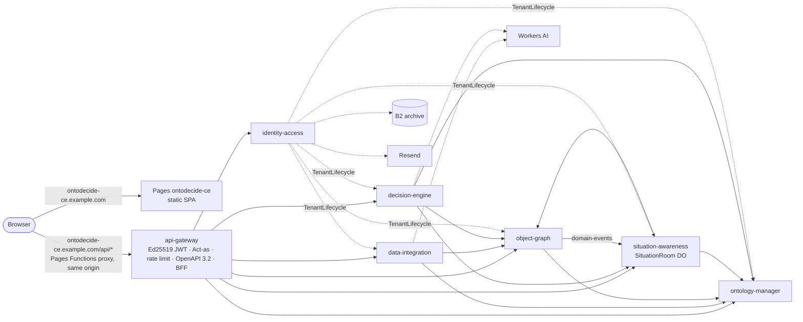

# OntoDecide CE

[](https://github.com/venslupro/ontodecide-ce/actions/workflows/ci.yml)
[](https://github.com/venslupro/ontodecide-ce/actions/workflows/deploy.yml)
[](https://github.com/RichardLitt/standard-readme)

> Ontology-driven data fusion for smarter, real-time decisions.

OntoDecide CE is the free public **Community Edition** of an ontology-driven decision intelligence platform. It covers the whole loop — import → fuse → situation → simulate → recommend → confirm → act — and runs entirely on the Cloudflare, Backblaze B2 and Resend free tiers.

Anyone can sign up with an e-mail code (no password, no credit card) and gets **one workspace for a 72-hour trial**, of which they are the only **Owner**. A new workspace starts **blank** (no object types). In it the Owner can:

* load one of six **example scenarios**, or model their own **ontology** of object types, properties, links and actions;
* **import** CSV / XLSX / JSON files — parsed in the browser, mapped with deterministic rules plus an optional AI draft, and written in batches;
* watch a real-time **cockpit** of KPIs, trends and alerts;
* run deterministic **what-if** simulations;
* get **recommendations** ranked and explained by Workers AI, and execute them after confirming;
* **clear** the workspace back to blank to switch scenarios.

When the trial ends, the workspace data is packed into one ZIP in Backblaze B2, a download link valid for 7 days is e-mailed, and the account — including the e-mail address — is deleted. The ZIP is deleted after 7 days. A single **bootstrap Admin** operates the platform: it is system-unique, never expires, cannot be deleted, signs in with an e-mail code plus a passkey, and every one of its actions is audited.

## Table of Contents

- [Security](#security)
- [Background](#background)
  - [Architecture](#architecture)
  - [Repository layout](#repository-layout)
  - [Free-tier guardrails](#free-tier-guardrails)
- [Install](#install)
- [Usage](#usage)
  - [Local development](#local-development)
  - [Example scenarios](#example-scenarios)
  - [Scripts](#scripts)
- [Deployment](#deployment)
  - [Configuration](#configuration)
  - [Pipelines](#pipelines)
  - [Domain](#domain)
  - [Secrets and variables](#secrets-and-variables)
  - [Upgrading from V1.3](#upgrading-from-v13)
  - [Go-live checks](#go-live-checks)
- [API](#api)
- [Maintainers](#maintainers)
- [Contributing](#contributing)
- [License](#license)

## Security

* Only the Pages project is reachable from the Internet. `/api/*` is proxied same-origin to api-gateway by a Pages Function; every other Worker sets `workers_dev: false` and is reached only through Service Bindings.
* api-gateway verifies Ed25519 JWTs (15-minute access tokens, at most 3 sessions per user), applies rate limits and enforces the OpenAPI contract. Errors follow RFC 9457 Problem Details.
* Tenant data in D1 goes through `TenantRepository`, which always binds `tenant_id`; `scripts/check_sql.mjs` (part of `pnpm lint`) rejects direct `.prepare(` calls outside a short list of tenant-agnostic exceptions.
* E-mail addresses are stored peppered and encrypted (`EMAIL_PEPPER`, `EMAIL_ENC_KEY`). Raw import files never leave the browser — only mapped JSON rows are sent.
* The SPA ships a strict Content-Security-Policy and HSTS ([`apps/web/public/_headers`](apps/web/public/_headers)). Sign-up and sign-in are protected by Cloudflare Turnstile.
* The Admin can act as a workspace (Act-as) only with an audited, explicit target; its sessions last at most 8 hours.

Please report vulnerabilities privately to the [maintainers](#maintainers) rather than in a public issue.

## Background

The design is specified in four documents (V2.4): 社区版设计修订说明书 (authoritative), 总体设计说明书, 详细设计说明书 and 前端详细设计说明书. [`docs/ARCHITECTURE.md`](docs/ARCHITECTURE.md) maps them onto this repository; [`docs/ROLES.md`](docs/ROLES.md) describes the Owner and Admin roles.

### Architecture



The system is 7 Workers plus 1 static Pages project. Five Workers each own one D1 database; situation-awareness keeps its data in one Durable Object per workspace. Queues: `domain-events` and `dead-letter`. Crons: identity-access every 2 minutes (`*/2`) and object-graph every 15 minutes (`*/15`).

Every deployed resource is named `{project}-{env}-{service|module}`, for example `ontodecide-prd-api-gateway`, `ontodecide-prd-object-graph-db`, `ontodecide-prd-domain-events` and `ontodecide-prd-archive`. Two resources are exceptions: the Pages project `ontodecide-ce` and the Terraform state bucket `ontodecide-ce-tfstate`.

| Worker | Bounded context | Owns |
| --- | --- | --- |
| `api-gateway` | — (access layer, BFF) | nothing (4 Rate Limiting bindings) |
| `identity-access` | Identity & tenant lifecycle | D1 `…-identity-access-db`, B2 `…-archive`, e-mail |
| `ontology-manager` | Ontology (core) | D1 `…-ontology-manager-db` |
| `data-integration` | Data fusion (supporting) | D1 `…-data-integration-db`, Workers AI (mapping drafts) |
| `object-graph` | Object graph (core) | D1 `…-object-graph-db`, producer of `…-domain-events` |
| `situation-awareness` | Situation (supporting) | Durable Object `SituationRoom` (SQLite) |
| `decision-engine` | Decision (core) | D1 `…-decision-engine-db`, Workers AI (`@cf/qwen/qwen3-30b-a3b-fp8`, `@cf/openai/gpt-oss-20b` fallback) |

### Repository layout

Layout and naming follow Google TypeScript Style (`gts`).

```
apps/<worker>/            wrangler.jsonc.tpl + src/{env,container,service,index}.ts
apps/api-gateway/openapi.yaml   OpenAPI 3.2.0 — the public API contract
apps/web/                 React 19 + Vite SPA (zh-CN / en-US), Pages Functions proxy, Playwright e2e
packages/shared-kernel/   CallCtx, errors (RFC 9457), Ed25519 JWT, filters, limits, lifecycle types; ./d1 repositories
packages/<context>/       contract/ domain/ application/ infrastructure/ interface/
packages/testing/         D1 over node:sqlite, DO SQL storage, queues, RPC bindings, Workers AI and rate-limit fakes
migrations/<service>/     D1 migrations (one directory per database)
infra/                    Terraform: D1, Queues, B2 bucket + keys, Turnstile, pages.dev bulk redirect
scripts/                  dev, smoke, code generation, migration, checks and operations scripts (see Usage)
samples/<scenario>/       CSVs mirroring each built-in scenario's sample rows
tests/e2e/                in-process full-loop tests through the gateway
tests/budget/             D1 rows-written and CPU timing budgets
tests/contract/           response bodies vs openapi.yaml
```

### Free-tier guardrails

* **Admission control:** ≤ 20 sign-ups per day, ≤ 60 active trial workspaces and a purge backlog of ≤ 10 (the Admin may lower the first two). Sign-up closes automatically at 80 % of any account-wide quota.
* **Per-workspace limits** (`CE_LIMITS` in `packages/shared-kernel`): ≤ 300 objects, ≤ 900 links, ≤ 2,000 imported rows per day, ≤ 3 AI recommendations and ≤ 2 AI mapping drafts per day, ≤ 3 scheduled automations, 5 MB per import file, 512 KB per request body.
* **Low D1 writes:** `WITHOUT ROWID` tables, a single index on property values, single-statement `json_each` batch writes, and no write when the props hash is unchanged.
* **Atomic capped counters** guard every scarce action.
* **Degradation paths:** when the AI quota runs out or a model fails, recommendations fall back to rule ranking (labelled 「规则排序」). When Resend is over quota or returns 429 / 5xx, e-mail is deferred to the next cron tick. When the WebSocket fails, the cockpit polls every 30 s.

## Install

Requirements:

* Node.js ≥ 22.13 (for `node:sqlite` in tests)
* pnpm 9 (via Corepack)
* Terraform ≥ 1.10, only if you manage infrastructure

```bash
corepack enable && pnpm install
```

## Usage

### Local development

```bash
pnpm dev
```

This starts all 7 Workers in one `wrangler dev` session on `:8787` (local D1, Durable Objects and Queues — no Cloudflare quota is used) and the web app on `:5173`, which proxies `/api` and the WebSocket like production does.

Open the app at http://localhost:5173 (not `127.0.0.1`: the WebAuthn RP id is `localhost`). Locally:

* no e-mail is sent (`EMAIL_MODE=log`) — the identity-access log prints each sign-in code;
* Turnstile uses Cloudflare's always-pass test keys;
* without B2 keys, archives are kept in memory;
* the admin e-mail and setup code are in `.wrangler/dev-secrets.json`, generated once by `gen_wrangler --env local`;
* crons can be triggered at `http://127.0.0.1:8787/__scheduled?cron=...`.

`pnpm dev --api-only` starts the Workers without the web app. `pnpm dev` resets the local `.wrangler/state` if it still holds a V1.3 schema.

Check everything offline, and smoke-test a running `pnpm dev`:

```bash
pnpm typecheck && pnpm lint && pnpm test
```

```bash
pnpm smoke
```

### Example scenarios

A blank workspace can load one example scenario from the cockpit. A workspace holds one scenario at a time: to switch, clear it first (Account & data → clear workspace data), which returns it to the blank template. Each scenario's rows are also available as CSVs under [`samples/`](samples) for trying the import wizard.

| Scenario | id | Objects | Links |
| --- | --- | ---: | ---: |
| Supply Chain Risk Monitoring | `supply-chain` | 80 | 160 |
| Urban Situational Awareness & Emergency | `urban-emergency` | 30 | 18 |
| Industrial Predictive Maintenance | `predictive-maintenance` | 33 | 23 |
| Financial Anti-Fraud & Compliance | `financial-fraud` | 35 | 42 |
| Energy Grid Operation Optimization | `energy-grid` | 26 | 28 |
| Multi-source Intelligence Fusion | `intelligence-fusion` | 33 | 48 |

To import your own data, the workspace needs at least one object type: define one in the ontology workbench or load a scenario first.

### Scripts

| Command | What it does |
| --- | --- |
| `pnpm dev` | Full local stack (`scripts/dev.sh`) |
| `pnpm typecheck` | TypeScript for all packages and the web app |
| `pnpm lint` | ESLint (gts), dependency-cruiser and the SQL tenant-scope check |
| `pnpm test` | All Vitest suites plus script self-tests |
| `pnpm test:coverage` | Tests with the coverage gate (`packages/**/domain` ≥ 80 % lines) |
| `pnpm test:cpu` | CPU timing budgets |
| `pnpm test:e2e` | Playwright e2e for the web app |
| `pnpm build:web` | Production web build |
| `pnpm smoke` | HTTP smoke test against `pnpm dev` |
| `pnpm gen:wrangler` | Render `wrangler.jsonc` from the templates and Terraform outputs |
| `pnpm gen:secrets` | Generate the signing and encryption secrets |
| `pnpm format` / `pnpm fix` | Prettier / ESLint autofix |

Operations scripts in [`scripts/`](scripts): `d1_migrate.mjs` (D1 migrations), `check_openapi.mjs` and `check_bundle.mjs` (CI checks), `admin_pending_change.mjs`, `reset.sh` and `cleanup_legacy.sh`.

## Deployment

There is one environment, **production** (GitHub environment `production`), deployed only from `main`.

### Configuration

Each kind of configuration has exactly one source of truth.

| What | Source of truth | Tool |
| --- | --- | --- |
| D1 ×5, Queues ×2, B2 archive bucket + keys, Turnstile, pages.dev bulk redirect | `infra/*.tf` | Terraform (state in B2 `ontodecide-ce-tfstate`) |
| Workers: code, bindings, vars, crons, DO migrations, queue consumers | `apps/*/wrangler.jsonc.tpl` | Wrangler (`scripts/gen_wrangler.mjs` renders ids from `terraform output -json`) |
| Pages project `ontodecide-ce`, custom domain, SPA deployment | `apps/web/wrangler.jsonc` | Wrangler (`wrangler pages project create`, `wrangler pages domain create`, `wrangler pages deploy dist`) |
| D1 schema | `migrations/<service>/*.sql` | `wrangler d1 migrations apply` |
| Secrets | GitHub Secrets + sensitive Terraform outputs | `wrangler secret bulk` |

### Pipelines

CI, Terraform and Deploy start together on every pull request and every push to `main`. On a PR they stop before any approval and never change production. On `main`, Terraform Apply and Deploy's Approve job each wait for a reviewer (environment `production`); normally:

```
CI green → approve Terraform apply → approve Deploy
```

* **`ci.yml`** — typecheck; lint (gts, dependency-cruiser, SQL tenant-scope check); OpenAPI lint (official 3.2 schema + JSON Schema 2020-12); all Vitest suites with the coverage gate; CPU budgets; script self-tests; the web build with bundle budgets (60 KB gzip hard load for `/ended`); Worker dry-run bundles; Playwright e2e; and a non-blocking Lighthouse CI run (LCP ≤ 2.5 s).
* **`terraform.yml`** — Format → Validate → Lint → Plan on every PR and on `main`. Apply runs only on `main`, only when the plan has changes, and only after approval. A nightly run checks for drift.
* **`deploy.yml`** — Build (production configs, dry-run bundles, web build) on every PR. On `main` it pauses for one approval, then deploys each service in its own job in dependency order:

  ```
  ontology-manager ─► object-graph ─► situation-awareness ─► decision-engine ─┐
                          └──────────► data-integration ─────────────────────┤
                                                        identity-access ◄────┘ ─► api-gateway ─► Pages
  ```

### Domain

Set `APP_DOMAIN` (GitHub variable) to the apex domain whose DNS stays with its registrar (e.g. `opcbridge.top`). The project creates no Cloudflare zone and no Workers Route: point a CNAME `ontodecide-ce.<domain>` → `ontodecide-ce.pages.dev` at your DNS provider. Wrangler attaches the Pages custom domain in the CD pipeline; Terraform only creates the account-level pages.dev → custom-domain bulk redirect.

The SPA is served at `https://ontodecide-ce.<domain>` and the API at `https://ontodecide-ce.<domain>/api/*` through the Pages Function [`apps/web/functions/api/[[path]].ts`](apps/web/functions/api/%5B%5Bpath%5D%5D.ts) (GATEWAY service binding, same origin). Until `APP_DOMAIN` is set, the SPA falls back to `https://ontodecide-ce.pages.dev` with the same proxy.

### Secrets and variables

The full list with comments is in [`.env.example`](.env.example).

**GitHub secrets:**

- Cloudflare: `CF_API_TOKEN` (Workers, D1, Queues, Pages, Turnstile, account rulesets/lists, Pages custom domain), `CF_ACCOUNT_ID`.
- Backblaze: `B2_MASTER_KEY_ID` / `B2_MASTER_KEY`, and optionally `B2_STATE_KEY_ID` / `B2_STATE_KEY`.
- Signing and encryption: `JWT_SIGNING_KEY` (Ed25519 JWK; add `JWT_SIGNING_KEY_PREV` during a key rotation), `EMAIL_PEPPER`, `EMAIL_ENC_KEY`, `BOOTSTRAP_ADMIN_SETUP_CODE`. Generate all four with `pnpm gen:secrets`.
- E-mail: `RESEND_API_KEY`.
- Optional: `CF_ANALYTICS_TOKEN` (read-only Analytics token, for the account-wide 80 % check).
- `NEO4J_AURA_CLIENT_ID` / `NEO4J_AURA_CLIENT_SECRET`: keep only until the [V1.3 cleanup](#upgrading-from-v13) is done.

The Turnstile secret and the B2 archive keys come from Terraform outputs; you don't set them yourself.

**GitHub variables:**

- `BOOTSTRAP_ADMIN_EMAIL`, set on the `production` environment.
- `APP_DOMAIN`.
- `MAIL_FROM`: defaults to `noreply@mail.<domain>`; required when no domain is set.
- Optional: `EMAIL_MODE`, `ARCHIVE_SIGN_SLOT`, `D1_RESET_LEGACY`.

### Upgrading from V1.3

One time, for an existing V1.3 deployment:

1. Merge to `main`. Terraform stops managing the old resources without deleting them: the KV namespaces, the 10 queues, the raw bucket and its key, the situation D1 and the Neo4j instance (`infra/legacy.tf`).
2. Set the variable `D1_RESET_LEGACY=true` for **one** deploy. The V2.4 schema replaces the V1.3 one, and **all data in the five databases is dropped**; without the flag, the deploy stops before touching them.
3. Remove `D1_RESET_LEGACY`. Run `scripts/cleanup_legacy.sh`, which deletes the released resources and old Worker secrets, skipping anything still bound. Then delete `infra/legacy.tf`, the neo4jaura provider, the AURA secrets, the old secrets `JWT_SECRET`, `APPROVAL_SECRET`, `WRITEBACK_SECRET`, `CONNECTOR_ENC_KEY`, `BOOTSTRAP_ADMIN_PASSWORD`, `GEMINI_API_KEY`, `GROQ_API_KEY` and the variables `APP_BASE_URL`, `EMAIL_FROM`.
4. In the Resend dashboard, turn off open and click tracking so archive download links in e-mails are not rewritten. HSTS and other zone TLS settings are the zone owner's responsibility.

### Go-live checks

The design asks for three live checks before go-live:

- `/api/*` on `ontodecide-ce.<domain>` reaches api-gateway through the Pages Function proxy, not the static Pages host.
- Workers AI `@cf/qwen/qwen3-30b-a3b-fp8` accepts `enable_thinking: false` and JSON-schema output (the code falls back to `@cf/openai/gpt-oss-20b` automatically either way).
- The Rate Limiting bindings work on the Free plan.

## API

The public HTTP API is specified in [`apps/api-gateway/openapi.yaml`](apps/api-gateway/openapi.yaml) (OpenAPI 3.2.0) and served under `/api/*`. CI lints the spec, and `tests/contract/` checks real response bodies against it. Errors are RFC 9457 Problem Details with a `traceId`. Real-time cockpit updates use a WebSocket stream opened with a short-lived (30 s) ticket.

## Maintainers

[@venslupro](https://github.com/venslupro)

## Contributing

Questions and bug reports are welcome as [GitHub issues](https://github.com/venslupro/ontodecide-ce/issues). Before opening a pull request against `main`:

1. Follow Google TypeScript Style (`gts`) and the bounded-context layout above.
2. Run `pnpm typecheck && pnpm lint && pnpm test` — everything runs offline.
3. Use [Conventional Commits](https://www.conventionalcommits.org/) (`feat(web): …`, `fix(ontology): …`).

Pull requests are squash-merged.

## License

Private, closed-source project © OntoDecide Team

For licensing or business inquiries, please contact the [maintainers](#maintainers).
